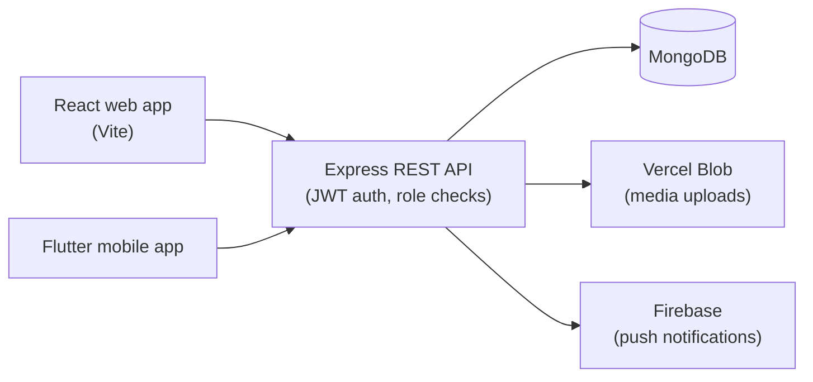

# El Tur Coptic

Ministry management platform with a React web app, a Flutter mobile app and a shared Express and MongoDB REST API. It organizes students into study groups and gives each group's administrators their own scoped view of content, activities, attendance, tasks and quizzes.

**[Live site](https://eltur-coptic.vercel.app)**


<!-- Add screenshots here, for example:  -->

## Architecture



Both clients use the same API. Database credentials and secrets stay in the backend and are never shipped inside a client.

## Features

- **Study groups and roles:** students register into one of six study groups. A public administrator manages everything, while stage administrators only see and manage their own group. These limits are enforced in backend queries and write checks, not only in the navigation.
- **Learning content:** quizzes with attempts, tasks, daily readings, a featured verse, a Bible reader, a prayer book reader and a liturgy schedule.
- **Activities:** attendance tracking, trips and registrations, a photo gallery and newsletters.
- **Notifications:** push notifications through Firebase on mobile.
- **Dashboards:** administrator and group-leader views on web and mobile.
- **Public pages** are prerendered at build time for faster loading and better search indexing.

## Tech Stack

| Layer | Technologies |
| --- | --- |
| Web | React, Vite, React Router, Vercel Blob, PDF.js |
| Mobile | Flutter, Firebase Cloud Messaging |
| API | Node.js 24, Express, Mongoose, JSON Web Tokens, Multer, Firebase Admin |
| Database | MongoDB (14 Mongoose models) |
| Hosting | Vercel (web and API as separate projects) |

## Project Structure

```text
backend/    Express API: routes, models, middleware, services, scripts, tests
frontend/   React web client (Vite)
Mobile/     Flutter mobile client
shared/     Shared registration options used by web and mobile
scripts/    Tooling, including registration option sync
```

## Getting Started

**Requirements:** Node.js 24.x LTS, a MongoDB database and, for mobile, the Flutter SDK.

1. Configure the backend:

   ```bash
   cp backend/.env.example backend/.env
   ```

   | Variable | Description |
   | --- | --- |
   | `MONGODB_URI` | MongoDB connection string |
   | `DB_NAME` | Database name (`eltor_coptic`) |
   | `JWT_SECRET` | Strong random secret, at least 32 characters |
   | `FRONTEND_URL`, `CLIENT_ORIGIN` | Allowed frontend origins |
   | `PORT`, `NODE_ENV` | Server port and environment |

2. Configure the web client. `VITE_API_URL` is public configuration, not a database string:

   ```bash
   cp frontend/.env.example frontend/.env
   # set VITE_API_URL=http://localhost:8000/api
   ```

3. Start the API and the web app in separate terminals:

   ```bash
   cd backend && npm ci && npm start
   ```

   ```bash
   cd frontend && npm ci && npm run dev
   ```

4. Check the API at `http://localhost:8000/api/health`. It should return `{"status":"ok","database":"mongodb"}`.

### Mobile app

The Flutter source is in `Mobile/`. By default it connects to the production API. Override it at build time:

```bash
cd Mobile
flutter run --dart-define=API_BASE_URL=http://10.0.2.2:8000/api   # Android emulator
flutter build apk                                                   # production Android package
```

See [`Mobile/README.md`](Mobile/README.md) for details.

## Roles and Study Groups

Students pick one of six study groups at registration: primary grades 1–3, primary grades 4–6, preparatory, secondary, university or expatriates. Content, activities, attendance, tasks and quiz results are filtered by study group and, where configured, by meeting group.

- The `admin` role is the public administrator and can manage all groups.
- Stage administrators are assigned by the public administrator and can only see and manage data inside their assigned group.
- New content created by a stage administrator is automatically scoped to that group. Older content without an audience stays hidden from students until the public administrator reviews it.

## Testing

```bash
cd backend && npm test                      # syntax checks + Node test runner
cd frontend && npm test && npm run lint && npm run build
```

The backend tests cover authentication and sessions, validation, rate limiting, security headers and notifications.

## Deployment

Use two Vercel projects connected to this repository.

| Project | Root Directory | Notes |
| --- | --- | --- |
| Web frontend | `frontend` | Build `npm run build`, output `dist`. Leave `VITE_API_URL` unset in production so `/api` stays same-origin and secure cookies work. Set `VITE_SITE_URL` for canonical links and the sitemap. |
| API backend | `backend` | Set `MONGODB_URI`, `DB_NAME`, `JWT_SECRET`, `CRON_SECRET`, `FRONTEND_URL` and `CLIENT_ORIGIN`. Add `FIREBASE_PROJECT_ID` and `FIREBASE_SERVICE_ACCOUNT_JSON` for immediate push alerts. |

Keep `MONGODB_URI` and `JWT_SECRET` only in the backend project's environment variables. Build the mobile app separately from `Mobile/`.

## Documentation

- [`backend/README.md`](backend/README.md): API routes, account setup and production data handling
- [`backend/DATABASE_BACKUP.md`](backend/DATABASE_BACKUP.md): encrypted database backup and isolated restore procedure

## Author

**Abanoub George**, Junior Full-Stack Developer · [LinkedIn](https://www.linkedin.com/in/abanob-george-samir) · [GitHub](https://github.com/AbanobGeorgeSamir)
